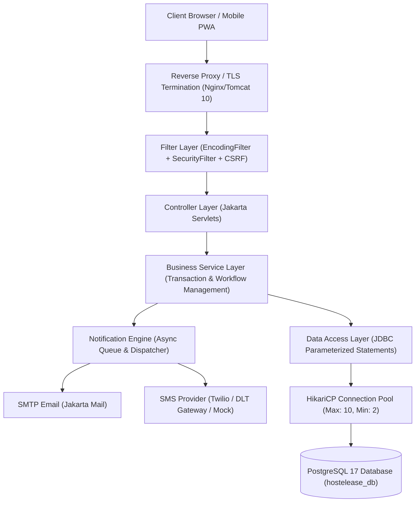
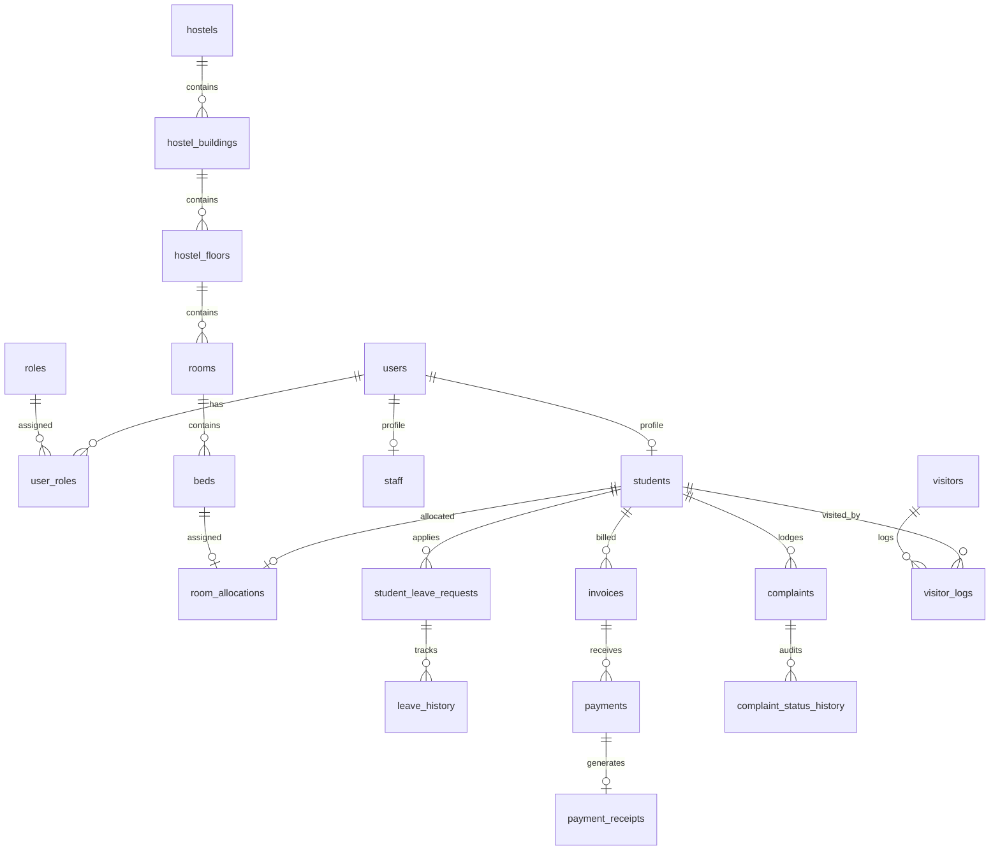

# HostelEase — System Architecture & Design Specification

## 1. System Overview
**HostelEase** is an enterprise-grade Smart Hostel Management Web Application designed for universities, colleges, and residential housing facilities. It adheres strictly to the **Jakarta EE 10 / Servlet 6.0** specification, running on **Apache Tomcat 10.1.x** with a high-performance **PostgreSQL 17** relational database backend.

---

## 2. Layered MVC Architecture


---

## 3. Core Relational Architecture (30 Tables)


---

## 4. Temporary Holiday Vacancy Protocol
```mermaid
sequenceDiagram
    autonumber
    actor S as Resident Student
    actor W as Campus Warden
    participant App as HostelEase System
    participant DB as PostgreSQL 17

    S->>App: Submits Leave Application (Dates, Reason, Emergency Contact)
    App->>DB: Insert into student_leave_requests (Status: PENDING)
    App-->>W: Notification: New Leave Application Awaiting Review
    W->>App: Reviews & Approves Leave Request
    App->>DB: Status -> APPROVED (Student remains PRESENT until departure)
    Note over S,DB: Bed remains ALLOCATED. Unique index uq_active_bed_allocation locked.
    S->>W: Physical Gate Departure (Check-Out)
    W->>App: Confirm Departure
    App->>DB: Status -> DEPARTED | Student Presence -> AWAY
    Note over App,DB: Bed status displays "Temporarily Vacant - Student Away"
    App-->>W: Gate Roster updated; night attendance headcount adjusted
    opt Return on Time
        S->>W: Physical Gate Return (Check-In)
        W->>App: Confirm Student Return
        App->>DB: Status -> RETURNED | Student Presence -> PRESENT
        Note over App,DB: Temporary vacancy badge cleared. Bed occupied.
    end
    opt Overdue Return
        App->>DB: Scheduled Reconciliation identifies expected_return < NOW()
        App->>DB: Student Presence -> RETURN_OVERDUE
        App-->>W: Priority Flashing Alert on Warden Dashboard with Emergency Call Button
        Note over App,DB: Allocation remains preserved. Bed CANNOT be reallocated.
    end
```

---

## 5. Security Boundaries & Authorization Matrix
- **Admin**: Complete system governance, hostel configurations, room creations, fee schedules, audit logs.
- **Warden**: Restricted strictly to assigned hostel. Gate departures/returns, complaint resolutions, visitor gate passes.
- **Student**: Isolated strictly to personal records. Must never see other students' invoices, leaves, or complaints.

---

## 6. Scaling & High-Availability Roadmap
1. **Vertical Scale**: Optimized HikariCP pooling with PostgreSQL connection tuning (`cachePrepStmts=true`, `prepStmtCacheSize=250`).
2. **Horizontal Scale**: Stateless Jakarta Servlet session architecture with sticky sessions or Redis-backed distributed sessions when cluster exceeds 5,000 concurrent students.
3. **Database Read Replicas**: Direct all analytical dashboard views (`vw_hostel_occupancy`, `vw_fee_collection_summary`) to streaming read-only replicas.
